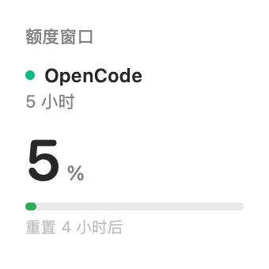
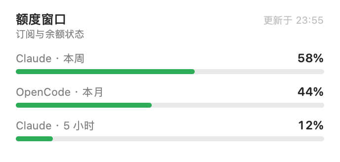
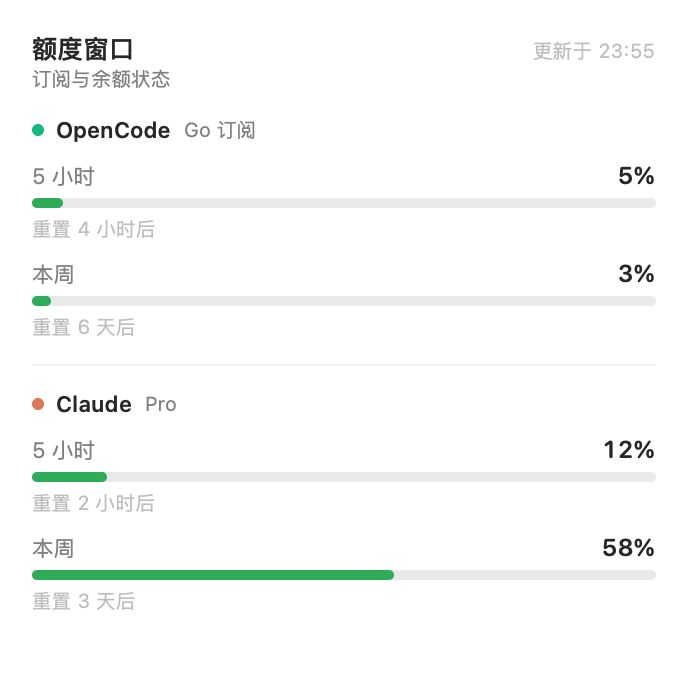

# macOS widgets

Infrastructure plugin: it displays **another plugin's** macOS widget style on the
desktop. It has no widget of its own. Plugins register a widget together with
their own style, the user picks which registered plugin to show in
**Settings → macOS Widgets**, and the WidgetKit companion renders that choice.

`quota-windows` is the first example below, not a dependency of this plugin.

| Small | Medium | Large |
| --- | --- | --- |
|  |  |  |

## How it fits together

| Part | File | Role |
| --- | --- | --- |
| Host | `index.js` | Registry service `ctx.macosWidgets`; fixed loopback bridge on `127.0.0.1:47823` (`GET /widgets`, `GET /widget`, `GET /widgets/<id>`); `GET /macos-widget/api/status` and `POST /macos-widget/api/select` on the DSH host. |
| Web | `client.js` | **Settings → macOS Widgets**: bridge status and the list of registered widgets with the current selection. |
| Native | `macos/` | SwiftUI host app plus one generic WidgetKit kind (`DSH 小组件`, small / medium / large) that reads the selected payload. |

The widget extension runs in the system widget host, outside the DSH page, so
it cannot use `dsh-app://` or the host session cookie. The bridge is the
smallest stable surface: loopback only, `GET` only, no credentials.

## Plugin contract

Any Host plugin registers a widget; the widget's appearance belongs to that
plugin through the `style` field. `quota-windows` is one example:

```js
ctx.inject(['macosWidgets'], (scope) => {
  scope.effect(() => scope.macosWidgets.register({
    id: 'quota-windows',
    title: '额度窗口',
    subtitle: '订阅与余额状态',
    read: async () => ({
      title: '额度窗口',
      subtitle: '订阅与余额状态',
      updatedAt: new Date().toISOString(),
      style: { layout: 'list', accent: '#4D6BFE', background: null, showUpdated: true },
      sections: [{
        id: 'opencode',
        title: 'OpenCode',
        subtitle: 'Go 订阅',
        accent: '#10B981',
        rows: [{ label: '本月', value: 44, max: 100, unit: '%', detail: '重置 3 天后' }],
      }],
    }),
  }), 'quota-windows: macOS widget')
})
```

`style` is the plugin-owned appearance contract:

| Field | Meaning |
| --- | --- |
| `layout` | `list` (sections and rows) or `single` (one tightest value). |
| `accent` | Fallback `#RRGGBB` for section markers. |
| `background` | Optional `#RRGGBB` card background. |
| `showUpdated` | Whether the header shows the update time. |

Each section and row can override `accent`; row `detail` is free text. The
native side never hardcodes a provider.

## Selecting the widget

Open **Settings → macOS Widgets** and click the plugin whose widget should
appear on the desktop. The selection lives in the host bridge; the native
surface picks it up on WidgetKit's next timeline refresh (15 minutes).

## Install

1. Link the plugin into a profile and add `dsh-macos-widget` to
   `dsh.profile.bundles`.
2. Build the WidgetKit companion (Xcode + `xcodegen` required):

   ```bash
   bash macos/build.sh
   ```

3. Restart DSH; **Settings → macOS Widgets** lists every plugin that registered
   a widget.
4. Desktop right-click → **Edit Widgets** → search `DSH Widgets` → add
   「DSH 小组件」. It shows whichever plugin is selected in Settings.

## Known limitations

- A plugin cannot load a WidgetKit extension at runtime; the extension ships in
  the companion app until DSH embeds one in its own bundle
  ([discussion](https://github.com/deepseek-ai/deepseek-harness/discussions/12763)).
- The companion is ad-hoc signed for local use; distribution needs a Developer ID.
- The bridge port is fixed. The selection is persisted to
  `$DSH_HOME/macos-widget/selection.json` and restored on the next Host start.
- Styles are template-based (`layout` + tokens). Fully custom per-plugin views
  would need host-side rendering of the plugin's Web surface.
